# OLS (Open Local Server)

> A free, open-source local development environment manager for Windows — runtimes, sites, databases, and trusted HTTPS, without touching your system by hand.

[](https://github.com/kz370/OpenLocalServer/actions)
[](./CHANGELOG.md)
[](./docs/STATUS.md)
[](./LICENSE)
[](./src-tauri/tauri.conf.json)
[](./crates/ols-core)
[](./docs/MCP.md)

**OLS** (Open Local Server) is an all-in-one local development environment for Windows engineered for native performance, broad runtime coverage, and full extensibility. Every project gets isolated runtimes, its own `.test` domain, and trusted local HTTPS without manual system configuration or virtual machine overhead.

One core engine (`ols-core`) powers four interfaces:
- **Desktop GUI (`OLS.exe`)**: Modern, borderless window with rich real-time monitoring and controls.
- **CLI (`olsc.exe`)**: Fast command-line interface with a lightweight background daemon.
- **Model Context Protocol (`ols-mcp.exe`)**: Stdio MCP server allowing AI coding assistants (Claude Desktop, Cursor, VS Code, LM Studio) to inspect and control your local environment.
- **Local HTTP API (`127.0.0.1:7420`)**: Scoped JSON API for local tooling and scripting.

**Free, open source, and unlimited sites.**

---

## Why I built it

I found plenty of free tools, but none had everything I wanted in one place. So I built one that does — first of all for myself. It is not made for profit, just to have the tool I wanted and to share it. It is and will stay completely free.

It is actively developed, so feedback, suggestions, and bug reports are very welcome.

---

## Contents

- [Download](#-download)
- [Tour](#-tour)
- [Features](#-features)
  - [Runtimes & Toolchain](#-runtimes--toolchain)
  - [Sites, Web Servers & HTTPS](#-sites-web-servers--https)
  - [Projects & Reproducible Environments](#-projects--reproducible-environments)
  - [Databases & Services](#-databases--services)
  - [Dashboard & Monitoring](#-dashboard--monitoring)
  - [Sharing & Tunnels](#-sharing--tunnels)
  - [MCP Server, CLI & API](#-mcp-server-cli--api)
- [Getting Started](#-getting-started)
  - [Prerequisites](#prerequisites)
  - [Install Dependencies](#install-dependencies)
  - [Run Locally (Dev)](#run-locally-dev)
  - [Build for Production](#build-for-production)
- [Usage](#-usage)
  - [Register a Project and Go Live](#register-a-project-and-go-live)
  - [Daily CLI Commands](#daily-cli-commands)
  - [AI Integration with MCP](#ai-integration-with-mcp)
  - [Typical Flow in GUI](#typical-flow-in-gui)
- [Project Structure](#-project-structure)
- [Built for AI, Built to be Forked](#-built-for-ai-built-to-be-forked)
- [Contributing](#-contributing)
- [Third-Party Notices](#-third-party-notices)
- [License](#-license)

---

## 📥 Download

Grab the latest installer (`OLS-2.4.0-setup.exe`) from the [Releases page](https://github.com/kz370/OpenLocalServer/releases).

- **What ships in the installer:** The desktop app (`OLS.exe`), the CLI (`olsc.exe`), the elevated helper service (`ols-helper.exe`), the MCP server (`ols-mcp.exe`), and the CPU limiter (`cpulimit.exe`).
- **Runtimes are downloaded on demand:** The app itself does not bundle third-party runtimes or databases. You download only the runtimes (PHP, Node.js, Python), web servers (Nginx, Apache, Caddy), and databases (MariaDB, PostgreSQL, MongoDB, Redis) you need with SHA-256 verification, or point OLS to existing installations already on your computer.
- **SmartScreen notice:** Until the installer binary is code-signed, Windows SmartScreen may display a warning. Click **More info**, then **Run anyway**.

---

## 📸 Tour

> Screenshots captured directly from the running app, showing **Dark** and **Light** themes side by side.

<p align="center">
  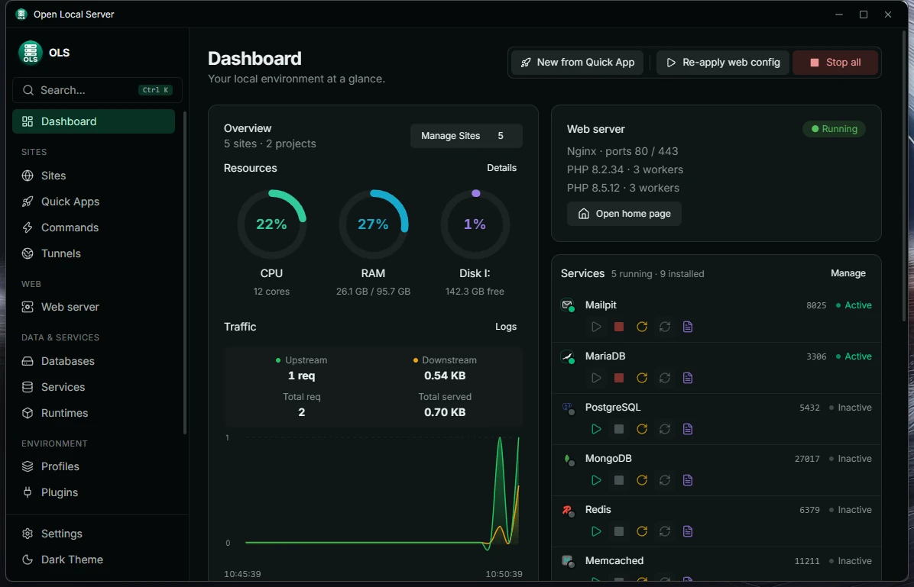
  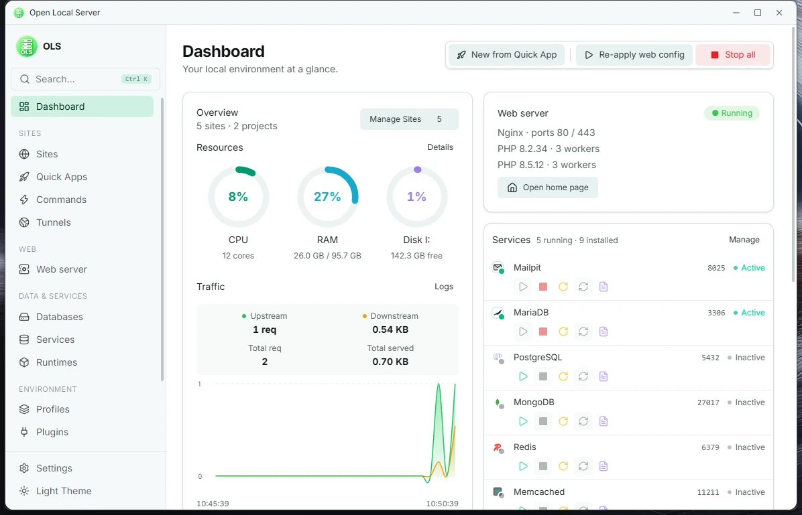
  <br><em>Dashboard — health, services, diagnostics, and traffic graph at a glance (Dark & Light)</em>
</p>

<p align="center">
  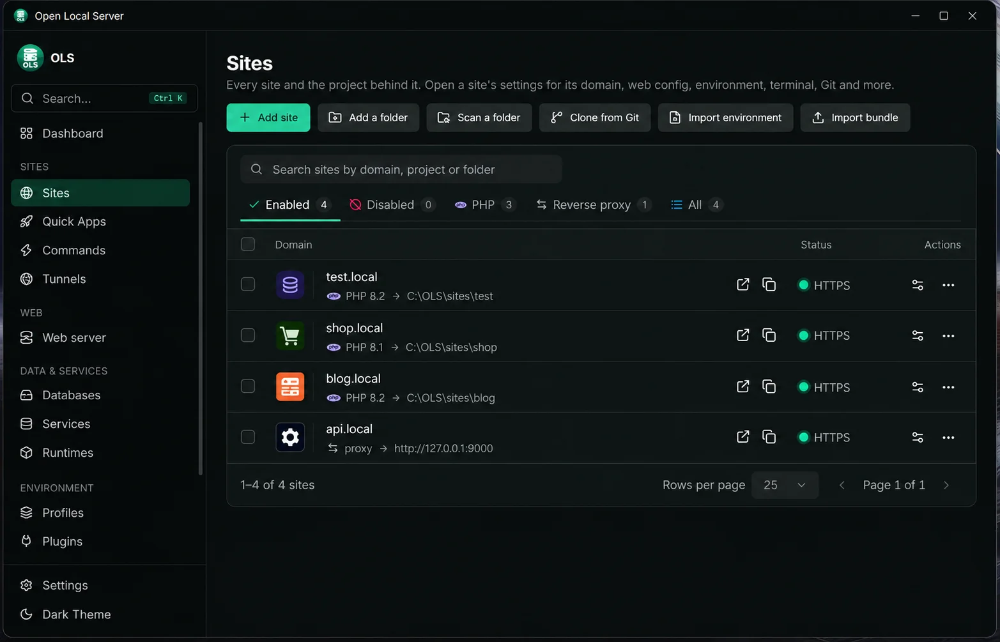
  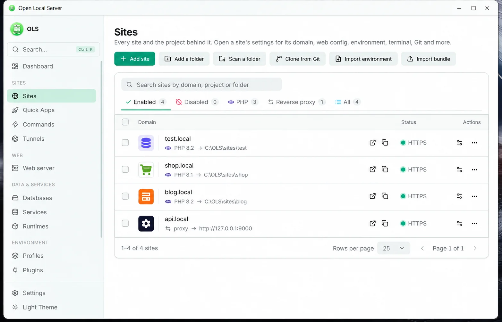
  <br><em>Sites — domains, per-site PHP/Node/Python, HTTPS, status tabs, and site branding (Dark & Light)</em>
</p>

<p align="center">
  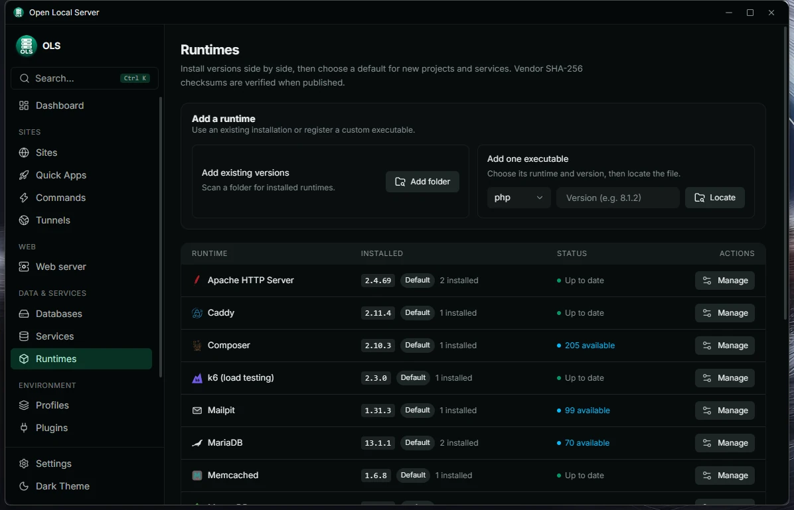
  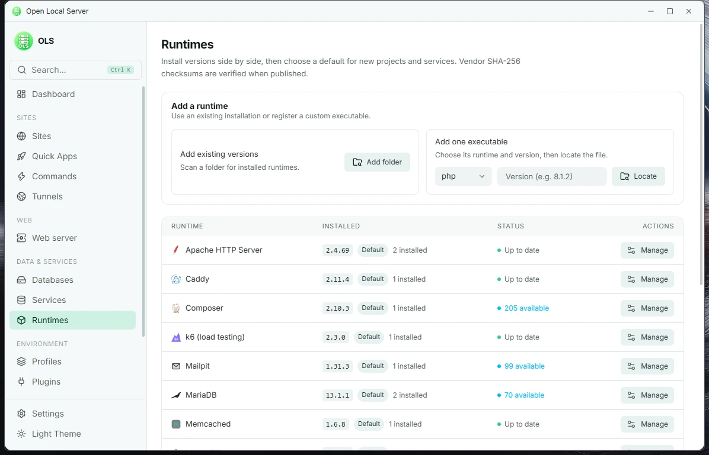
  <br><em>Runtimes — side-by-side versions, extensions, and global defaults (Dark & Light)</em>
</p>

<p align="center">
  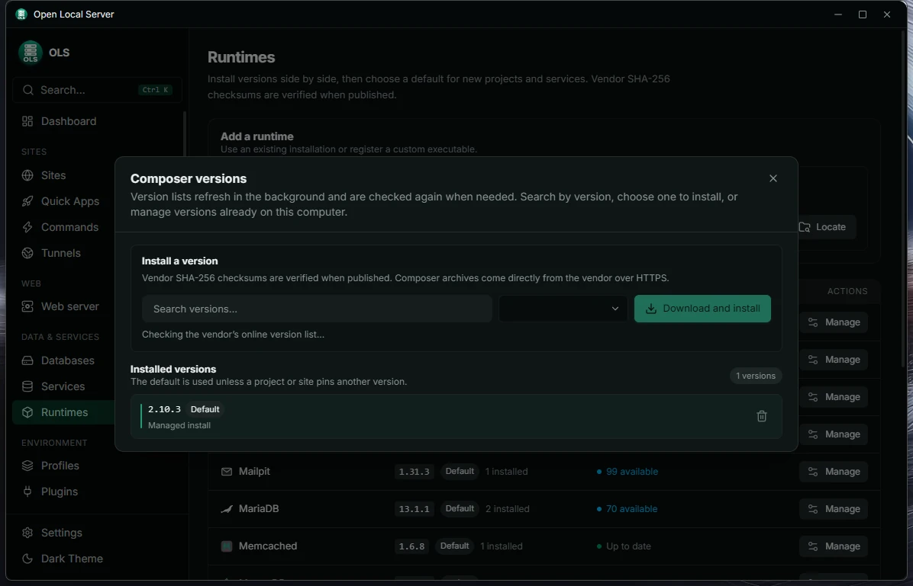
  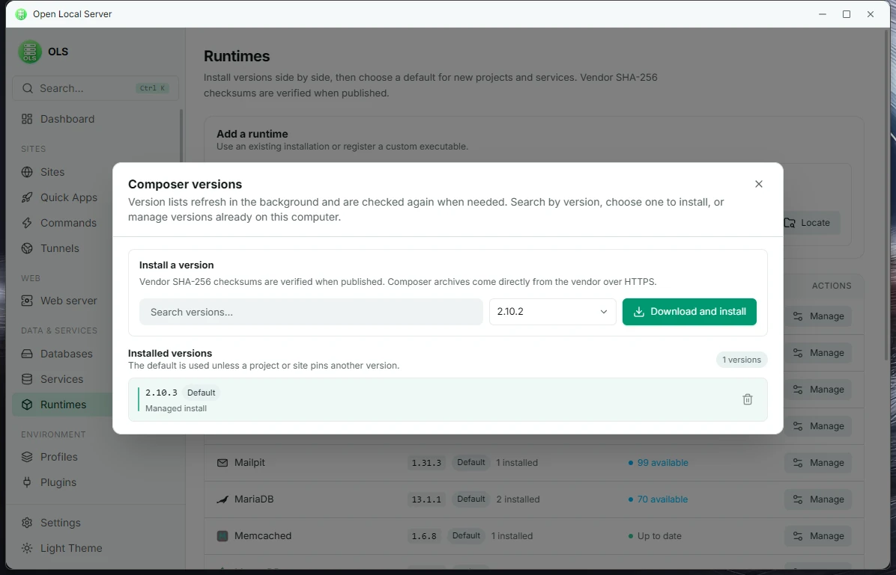
  <br><em>Version Manager — search, install, and manage runtime versions (Dark & Light)</em>
</p>

<p align="center">
  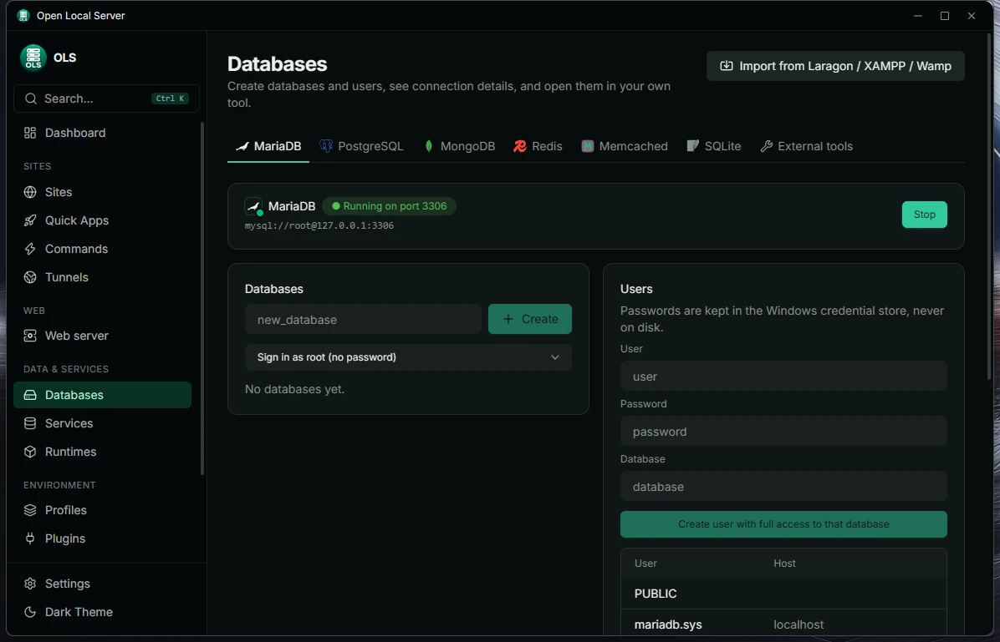
  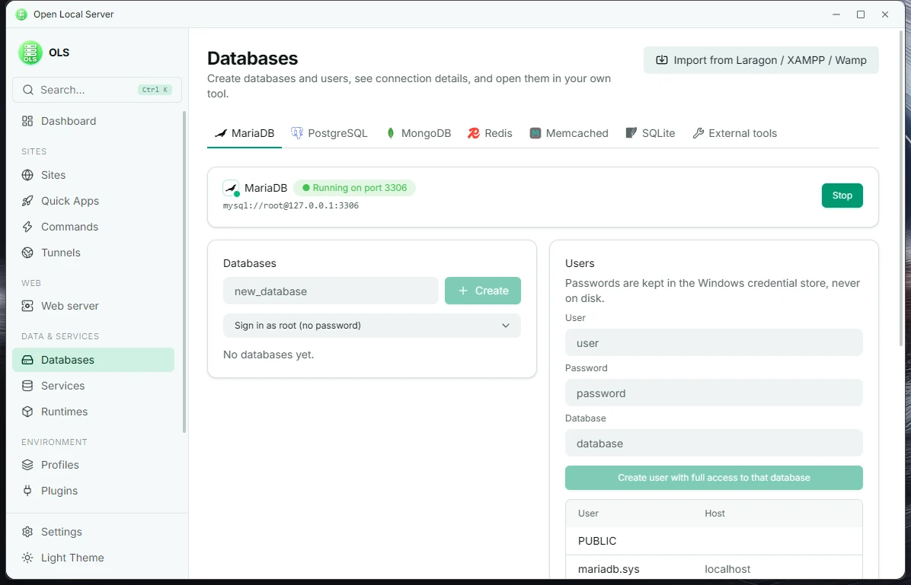
  <br><em>Databases — engines, users, backups, table inspection, and SQL tools (Dark & Light)</em>
</p>

<p align="center">
  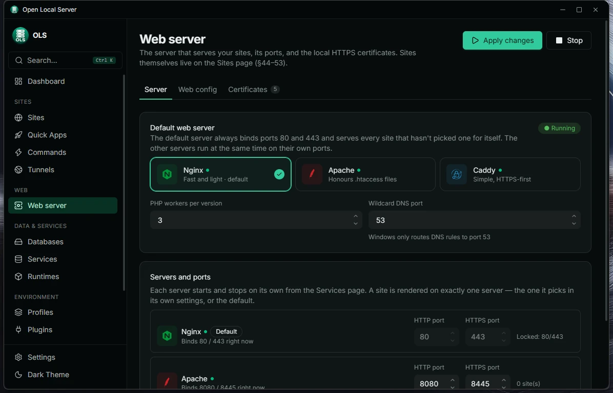
  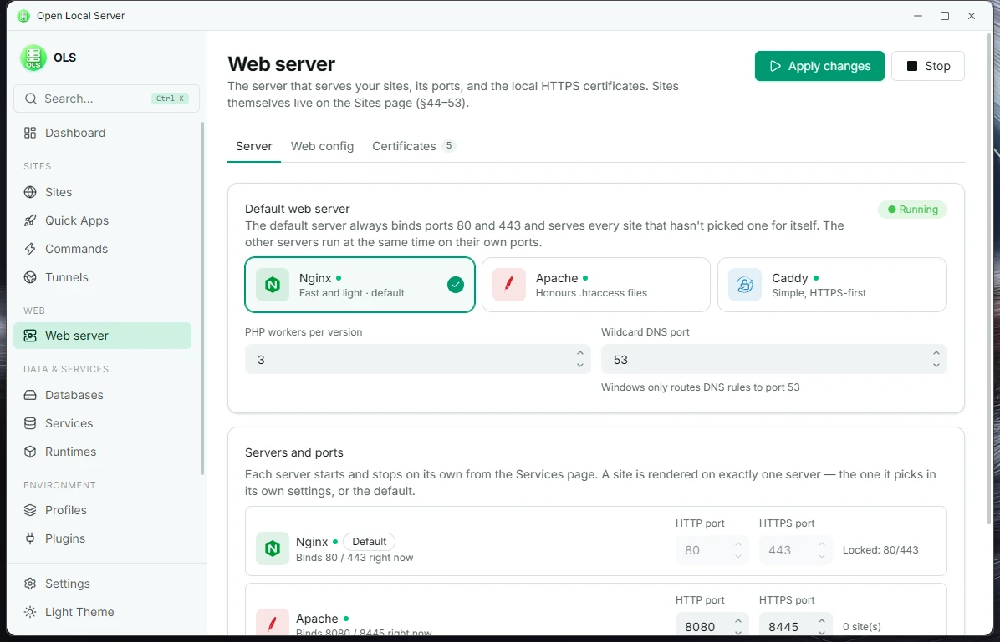
  <br><em>Web Server — live switching (Nginx / Apache / Caddy), syntax validation, and config history (Dark & Light)</em>
</p>

<p align="center">
  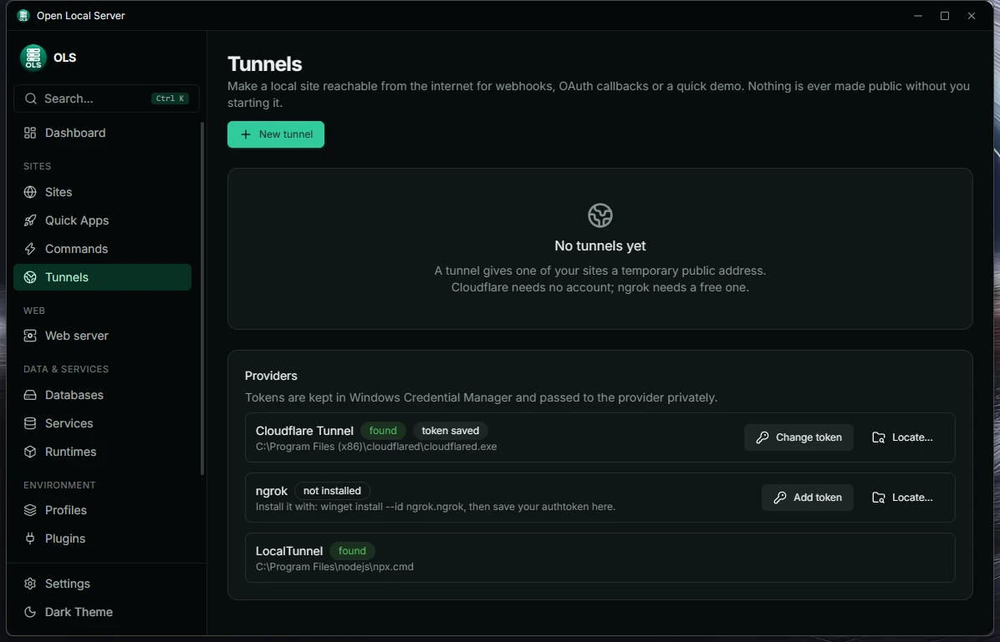
  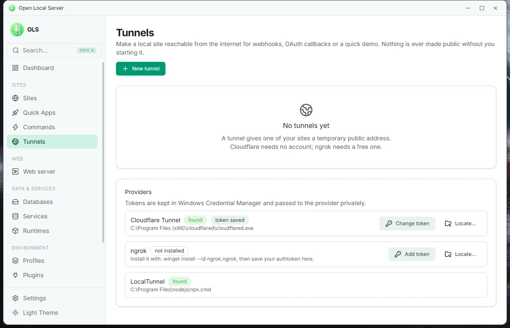
  <br><em>Tunnels — share a local site publicly, inspect traffic, and replay requests (Dark & Light)</em>
</p>

---

## ✨ Features

### 📦 Runtimes & Toolchain

- **Side-by-side versions** per runtime with a dedicated **Version Manager** dialog: search, install, default badge, and per-version file path display.
- **Managed lineup:**
  - **PHP:** NTS 8.1, 8.3, and 8.4 with per-version extensions, Xdebug 3 configuration, and PECL package support.
  - **Node.js:** Node 22 and 24 with corepack support (npm, pnpm, yarn, bun).
  - **Python:** Python 3.10, 3.11, 3.12, and 3.13 embedded packages, plus automated detection of system Python (3.7–3.15) and local virtual environments (`.venv`, `venv`). Supervised background dev server processes (`uvicorn`, `flask`, `django`, `waitress`, `streamlit`).
  - **Tooling:** Composer 2.10, portable Git 2.55, and k6 2.3 load testing.
- **Online catalogs** per runtime with vendor-published sources, 24-hour caching, background refresh, and **SHA-256 verification** on all downloads with atomic extraction.
- **Bring your own:** Scan folders for existing PHP installations (e.g. Laragon, XAMPP), or register custom executables (PHP, Node, Python) by locating the file.
- **Resolution order:** Project manifest pin > auto-detected from project files > global default. Changing a global default never touches existing project configurations.

### 🌐 Sites, Web Servers & HTTPS

- **Multiple ways to add a site:** Pick an existing directory, add a **project root folder** to automatically detect and register all subfolders as sites, clone directly from a **Git repository**, or scaffold with **Quick Apps**.
- **Automatic document root & welcome page:** When creating a new site, OLS automatically creates the document root folder and generates a default welcome file (`index.html` or `index.php`) if none exists.
- **Site status tabs & filtering:** Dedicated **Enabled**, **Disabled**, and **All** tabs with quick counts and distinct colored status indicators.
- **Safe deletion & folder exclusion:** Deleting or hiding a site moves its folder into an `ols_excluded_sites` subfolder (with automatic name collision resolution) instead of permanent disk deletion. Configurable ignored folders (`projects.ignored_folders`) in Settings.
- **Site branding & icons:** Custom site logos in table rows via local image upload with automatic WebP optimization, or a bundled offline Font Awesome icon catalog with swatch and custom color pickers.
- **Unlimited sites & domains:** Any domain name plus wildcard subdomains; automatic `<folder>.test` naming; static sites; reverse proxies to any `host:port`. Run on a domain, on `localhost/<prefix>`, or both simultaneously.
- **Multi-interface web binding (`0.0.0.0` & `127.0.0.1`):** Web servers bind across all local network interfaces, supporting LAN access and router port forwarding.
- **Trusted local HTTPS:** Built-in on-device Certificate Authority (CA), 397-day leaf certificates, automated renewal under 30 days, and SAN-aware reuse.
- **Per-site PHP version & per-site web server:** Each site can run on its own PHP version and web server (Nginx, Apache, or Caddy); unpinned sites cleanly follow global defaults.
- **Web server lineup:**
  - **Nginx 1.28 & 1.30**, **Apache 2.4 (2.4.69)**, and **Caddy 2.11 (2.11.4)** with generated configurations.
  - Caddy uses a stable localhost admin address derived from its install path, avoiding port 20019 collisions.
  - Managed, Advanced, and Manual modes; validate-before-reload with automatic rollback; **drift detection**; config revision history with diff and restore.
- **Zero-prompt DNS:** Built-in **wildcard DNS** for `.test`, `.localhost`, and `.internal`; elevated helper service for hosts file and NRPT rules (no repeated UAC popups).
- **Custom domains, site broadcast & Dynamic DNS (DDNS):** Support for 12+ DNS providers (Cloudflare, DuckDNS, No-IP, Dynu, ClouDNS, HE.net, Route53, Namecheap, GoDaddy, Porkbun, DigitalOcean, and custom webhooks) with auto-sync and IP change detection.
  - **Site Broadcast panel:** Live broadcast status and 1-click public URL copying integrated into the Site Domains panel.
  - **Router & port forwarding troubleshooting:** Guides for resolving HTTP Error 522 and CGNAT restrictions.

### 🧩 Projects & Reproducible Environments

- **Auto-detection:** Framework and version detection from `composer.json`, `package.json`, `manage.py`, and project markers.
- **Manifests (`.openlocalserver/*.yaml`):** Declarative environment specifications, services, custom commands, and lock files.
- **14-step setup pipeline:** Resolve → plan → conflict report → dry-run → apply, fully journaled with automatic **rollback** on failure and file locking.
- **Profiles & snapshots:** Development, Testing, Debugging, and Demo profiles; point-in-time snapshots and backups (zip, clone, import/export); lossless `.env` editor preserving comments, key order, and CRLF line endings.
- **Encrypted site bundles:** Export and import settings, `.env` files, database dumps, and project files with optional **Argon2id + ChaCha20-Poly1305** password encryption.
- **Quick Apps:** 13 built-in application recipes (Laravel, Symfony, WordPress, Express, React/Vite, Vue, Next.js, Django, FastAPI, static HTML…) — parameter validation → plan review → execution with step history.
- **Quick Commands:** Auto-discovered Composer, npm, and manage.py scripts with 1-click execution and terminal ring buffer, plus preconfigured commands for Laravel, Node, and Python.

### 🗄️ Databases & Services

- **Engines:** MariaDB (11.4 & 11.8), PostgreSQL (17.6), MongoDB (8.3), Redis (`redis-windows` 8.10), Memcached (1.6), Mailpit (1.31), SQLite (3.53).
- **Database inspection & SQL execution:** Table listing and direct SQL command execution (`SELECT`, `INSERT`, `UPDATE`, `CREATE TABLE`, etc.) across MariaDB/MySQL, PostgreSQL, and SQLite with client binary fallback (`mariadb.exe`, `mysql.exe`, `psql.exe`, `sqlite3.exe`).
- **Database & user management:** Create databases and users, view connection strings, perform point-in-time backups and restores (safety copy created first), SQLite `.backup` and integrity checks.
- **1-click external GUIs:** HeidiSQL, pgAdmin 4, NoSQLBooster, and Tiny RDM (auto-detected with connection URI copying).
- **Live-dump importers:** Direct migration from Laragon, XAMPP, and WampServer databases without requiring manual SQL dump exports.
- **Service lifecycle & mail capture:** Background service supervision with TCP health checks, Mailpit outgoing mail capture per framework with `.env` configuration diffs.
- **Resource limits:** Per-service limits on memory, CPU allocation, and process counts.

### 📊 Dashboard & Monitoring

- **Services card:** Built-in services in a clean, consistent order — start, stop, restart, reload, and logs color-coded per action with unavailable actions flattened.
- **Ports tab:** Clear rows per server (icon, name, HTTP, HTTPS, site count) with fixed-width port inputs; active default servers keep their 80/443 ports protected from accidental edits.
- **Custom input steppers:** Ports, worker counts, and memory limits use rounded in-app stepper chevrons with arrow key support.
- **Overview:** Active sites and projects counts, resource usage donuts (CPU, RAM, disk), and a 30-bucket web traffic graph with hover inspector.
- **Diagnostics & Doctor:** Detailed findings formatted as **Problem / Cause / Fix**, safe 1-click **auto-repair**, ignore rules, and redacted support bundle generation.
- **Unified logs viewer:** Multi-source severity-aware log viewer with real-time tailing, search, level filtering, clipboard copy, and export.
- **Processes & Background Tasks:** Process supervisor with CPU/RAM metrics, per-site usage rollups, and a background task registry with live step and progress tracking.
- **In-App User Manual & Release Notes:** Full documentation and release notes viewer embedded under `Settings → User Manual`.
- **Command palette (`Ctrl+Shift+P`) & Global search (`Ctrl+K`)**.

### 🔗 Sharing & Tunnels

- **Supported providers:** Cloudflare Tunnel (`cloudflared`), ngrok, LocalTunnel, and Tailscale.
- **Security controls:** Public exposure confirmation gate, optional basic password protection, public status badge, and 1-click stop.
- **Real-time traffic inspector:** Forwarding proxy, redacted request log (500-request ring buffer), request replay, and webhook tester. Captures standard HTTP requests while streaming WebSockets and chunked data directly through.

> **Note on tunnel binaries:** Tunnel executables are found on your system, not downloaded by OLS. Ensure `cloudflared` or `ngrok` is installed and available on your `PATH` (e.g. via `winget install Cloudflare.cloudflared`). ngrok authtokens are stored securely in Windows Credential Manager.

### 🤖 MCP Server, CLI & API

- **Model Context Protocol (MCP) Server (`ols-mcp`):** Native stdio MCP server shipping directly with OLS (`ols-mcp.exe`). Allows LLM hosts (Claude Desktop, Cursor, VS Code, LM Studio) to inspect and control OLS through JSON-RPC 2.0 tools:
  - **Domains & Sites:** `ols_list_domains`, `ols_get_domain`, `ols_add_domain`, `ols_update_domain`, `ols_remove_domain`, `ols_set_domain_enabled`, `ols_restart_site_app`.
  - **Project Inspection:** `ols_inspect_site_folder` (detects frameworks, virtualenvs, entry scripts, and start commands).
  - **Runtimes:** `ols_list_runtimes`, `ols_install_runtime`, `ols_refresh_runtimes`.
  - **Services & Tunnels:** `ols_list_services`, `ols_start_service`, `ols_stop_service`, `ols_restart_service`, `ols_list_tunnels`, `ols_start_tunnel`, `ols_stop_tunnel`.
  - **Databases & Tables:** `ols_list_databases`, `ols_create_database`, `ols_list_tables`, `ols_execute_sql`.
  - **Web Server:** `ols_apply_web`, `ols_validate_web`.
  - See [docs/MCP.md](./docs/MCP.md) for full configuration examples and tool schemas.
- **Command Line (`olsc`):**
  - Drive OLS from any shell: `olsc setup`, `olsc doctor`, `olsc repair`, `olsc status`, `olsc start`, `olsc stop`, `olsc restart`.
  - Full subcommands: `project`, `runtime`, `php`, `service`, `tunnel`, `worker`, `snapshot`, `quick-app`, `quick-command`, `search`, `guide`.
  - Background daemon: Automatically runs in the background (`olsc daemon`) when the GUI is closed.
- **Local HTTP API (`127.0.0.1:7420`):** Bearer token authenticated JSON API mirroring `CoreCommand` operations with read-only and operate scopes. See [docs/API.md](./docs/API.md).
- **Automation tools:** Background queue workers (max 16, Procfile.dev import), scheduled cron tasks (1-minute tick, overlap protection), portable-pty terminal shells, and Git repository management.
- **Extensibility & Plugins:** Declarative `plugin.yaml` extensions via minisign-signed catalogs, re-verified on every load. See [docs/PLUGINS.md](./docs/PLUGINS.md).

---

## 🚀 Getting Started

Most users only need the installer from the [Download](#-download) section. The instructions below are for building OLS from source.

### Prerequisites

| Requirement | Version | Notes |
|---|---|---|
| Windows | 10 / 11 (64-bit) | Windows-only |
| Rust | Stable (1.75+) | Installed via `rustup` |
| Node.js | 22 LTS or newer | UI compilation |
| Tauri Prerequisites | — | Microsoft C++ Build Tools (MSVC), WebView2 runtime |
| Inno Setup | 6 or 7 | Required only for building the setup installer |

### Install Dependencies

```powershell
# Install Rust toolchain (if not already installed)
winget install Rustlang.Rustup

# Install Node.js LTS (v22+)
winget install OpenJS.NodeJS.LTS --version 22

# Install UI packages
cd ui
npm install
cd ..
```

### Run Locally (Dev)

```powershell
# From the repository root — builds ols-helper and launches Tauri + Vite
.\scripts\dev.bat
```

This launches the desktop app with hot module reloading (Vite server running on `http://localhost:1420`).

### Build for Production

```powershell
# 1. Quality gates (must pass cleanly)
cargo fmt --all
cargo clippy -p ols-core -p ols-helper -p ols-mcp --all-targets
cargo test -p ols-core -p ols-helper -p ols-mcp

# 2. Build and validate UI
cd ui
npm run lint
npm run build
cd ..

# 3. Build complete installer (staged executables, embedded icons, Inno Setup)
scripts\build-installer.bat full
```

The resulting installer package will be output to `release\<version>\OLS-<version>-setup.exe`.

---

## 💻 Usage

### Register a Project and Go Live

```powershell
# Clone any PHP, Node, or Python project
git clone https://github.com/example/my-laravel-app.git
cd my-laravel-app

# Set up environment: runtimes → DB → domain → DNS → SSL → mail → workers
olsc setup

# Or preview the setup plan without making any changes
olsc setup --dry-run

# Run health diagnostics and automatically resolve safe issues
olsc doctor
olsc repair
```

### Daily CLI Commands

```powershell
olsc status                                              # View services, sites, runtimes, and health
olsc start                                               # Start the web server and enabled services
olsc stop                                                # Stop all web servers, services, workers, and tunnels
olsc restart                                             # Restart running services and servers

olsc project list                                        # List registered projects
olsc service list                                        # List background services (MariaDB, PostgreSQL, Redis, Mailpit...)
olsc runtime list                                        # List installed and available runtimes

olsc tunnel list                                         # List configured public tunnels
olsc tunnel start <name> --yes                           # Start a tunnel by name or project
olsc worker start <project>                              # Start background queue workers for a project
olsc snapshot create <project> --label "pre-migration"   # Create a point-in-time project snapshot
olsc search "mailpit"                                    # Search across projects, configs, services, and logs
olsc guide                                               # Display the comprehensive user manual
```

### AI Integration with MCP

You can connect your preferred AI coding assistant to OLS using the bundled `ols-mcp.exe` binary. For example, in **Claude Desktop** (`claude_desktop_config.json`) or **Cursor**:

```json
{
  "mcpServers": {
    "ols": {
      "command": "C:\\OpenLocalServer\\ols-mcp.exe"
    }
  }
}
```

Once connected, you can ask your AI assistant natural questions:
- *"List all my running sites and database services."*
- *"Create a new site called `api.test` pointing to `C:\sites\api` using PHP 8.4."*
- *"Create a MariaDB database named `shop_db` and list its tables."*
- *"Inspect the folder `C:\projects\fastapi-app` and configure a supervised site."*

### Typical Flow in GUI

1. **Add Site:** Register an existing folder, auto-scan a project root, or clone from Git. Frameworks and entry points are detected automatically.
2. **Setup:** Review the 14-step environment plan and click **Apply** (with automatic rollback on error).
3. **Open Site:** Click the domain link to open `https://myapp.test` with trusted local SSL.
4. **Develop:** Use the built-in `.env` editor, run commands from the Quick Commands panel, and view outgoing emails in Mailpit.
5. **Share:** Start a public tunnel with explicit confirmation and monitor requests in the real-time Traffic Inspector.

---

## 📁 Project Structure

```text
OpenLocalServer/
├── crates/
│   ├── ols-core/        # Application core — CoreCommand dispatcher, state management,
│   │                    # managers: Runtime, Service, Web, Domain, Certs, Project,
│   │                    # ProcessSupervisor, Workers, Scheduler, Tunnel, Mail,
│   │                    # Diagnostics, QuickApp, Plugin, Database Tools
│   ├── ols-helper/      # Elevated helper executable — manages hosts file and NRPT rules
│   │                    # via UAC or a LocalSystem named pipe (strictly validated API)
│   ├── ols-cli/         # CLI client (`olsc.exe`) — drives the app or background daemon
│   └── ols-mcp/         # Stdio Model Context Protocol server (`ols-mcp.exe`) for AI hosts
├── src-tauri/           # Tauri 2 desktop shell (`OLS.exe`) — windowing, tray, single IPC dispatcher
├── ui/src/              # React 19 + Vite 8 + Tailwind CSS 4 + shadcn/ui frontend
│   ├── pages/           # Dashboard, Sites, QuickApps, Commands, WebServer, Databases,
│   │                    # Services, Runtimes, Tunnels, Profiles, Plugins, Logs,
│   │                    # Processes, Tasks, Settings, Config
│   └── components/      # UI primitives, dialogs, form fields, and code editors
├── installer/           # Inno Setup packaging script (`open-local-server.iss`)
├── scripts/             # dev.bat, build-installer.bat, update-version.bat, upload-release.bat
├── specs/               # Single source of truth — architecture, catalog, data models,
│                        # relationships, API reference, runtime logs, and diagrams
├── docs/                # Comprehensive guides: OLS_USER_MANUAL.md, MCP.md, API.md, PLUGINS.md...
└── assets/              # App branding, icons, and README screenshots (.webp)
```

**Architecture (One Core, Multiple Front Doors):**

```text
Desktop GUI (React) ──┐
CLI (olsc) ───────────┼──> Core::dispatch(CoreCommand) ──> Arc<Inner> Shared State
MCP Server (ols-mcp) ─┤                                         │
HTTP API (127.0.0.1) ─┘                                         ▼
                                                      Managers:
                                                      Runtime, Service, Web, Domain,
                                                      Certs, Project, ProcessSupervisor,
                                                      Workers, Scheduler, Tunnel, Mail,
                                                      Diagnostics, QuickApp, Plugin
```

---

## 🤖 Built for AI, Built to be Forked

The entire project is built and documented with AI-pair engineering in mind:

- **Model Context Protocol (`ols-mcp`):** Native MCP tools expose full environment operations directly to LLMs.
- **Specifications as Truth (`specs/`):** The `specs/` directory defines architecture, catalogs, data models, relationships, and API specifications. Any code change updates matching specs.
- **Agent Guidelines (`AGENTS.md`):** Clear rules and quality gates guide automated agents and human contributors alike.
- **Structured Error Diagnostics:** All errors adhere to `Diagnostic{ problem, cause, fix }` so both users and AI assistants can automatically diagnose and repair issues.

Fork the repository, point an AI agent (Cursor, Claude, Antigravity) at the codebase, and customize it to suit your workflow.

---

## 🤝 Contributing

Contributions are very welcome! Please review [CONTRIBUTING.md](./CONTRIBUTING.md) and [CODE_OF_CONDUCT.md](./CODE_OF_CONDUCT.md) before submitting pull requests.

```powershell
# Mandatory Quality Gates — must pass before submitting a PR
cargo fmt --all
cargo clippy -p ols-core -p ols-helper -p ols-mcp --all-targets
cargo test -p ols-core -p ols-helper -p ols-mcp
cd ui
npm run lint
npm run build
```

- **Specs-sync mandate:** `specs/` is the single source of truth. Any functional change must update the corresponding specification files and append a log entry to `specs/runtime.md`.
- **Safety guarantees:** User errors use `Diagnostic{problem, cause, fix}`; file downloads must verify SHA-256; secrets remain exclusively in the OS keyring.
- **Commit convention:** Follow [Conventional Commits](https://www.conventionalcommits.org/) (`feat:`, `fix:`, `docs:`).

---

## 🧾 Third-Party Notices

OLS is licensed under **GPL-3.0-only** (see [LICENSE](./LICENSE)).

**The installer packages OLS companion binaries only (`OLS.exe`, `olsc.exe`, `ols-helper.exe`, `ols-mcp.exe`, `cpulimit.exe`) — no third-party runtimes, web servers, or databases are bundled.** Runtimes are downloaded on demand from official vendors, SHA-256 verified, and extracted into isolated OLS directories that you can remove at any time. Tunnel executables are neither downloaded nor installed; OLS locates existing binaries on your system `PATH`.

### Downloaded on Demand (NOT bundled in installer)

| Component | License | Official Source |
| :--- | :--- | :--- |
| PHP (NTS 8.1, 8.3, 8.4) | PHP License 3.01 | [windows.php.net](https://windows.php.net) |
| Composer 2.10 | MIT | [getcomposer.org](https://getcomposer.org) |
| Node.js (22, 24) | MIT | [nodejs.org](https://nodejs.org) |
| corepack / npm / pnpm / yarn / bun | MIT / Various | [nodejs.org](https://nodejs.org) |
| Python (3.10–3.13 embedded) | PSF License | [python.org](https://python.org) |
| Portable Git | GPL-2.0-only | [git-scm.com](https://git-scm.com) |
| k6 (Load Testing) | AGPL-3.0-only | [grafana.com/k6](https://grafana.com/docs/k6) |
| Nginx (1.28, 1.30) | BSD-2-Clause | [nginx.org](https://nginx.org) |
| Apache HTTP Server (2.4.69) | Apache-2.0 | [apachelounge.com](https://www.apachelounge.com) |
| Caddy (2.11.4) | Apache-2.0 | [caddyserver.com](https://caddyserver.com) |
| MariaDB (11.4, 11.8) | GPL-2.0-only | [mariadb.org](https://mariadb.org) |
| PostgreSQL (17.6) | PostgreSQL License | [postgresql.org](https://postgresql.org) |
| MongoDB (8.3) | SSPL-1.0 | [mongodb.com](https://mongodb.com) |
| Redis (`redis-windows` 8.10) | RSALv2 / SSPLv1 | [github.com/redis-windows](https://github.com/redis-windows) |
| Memcached (1.6) | BSD-3-Clause | [memcached.org](https://memcached.org) |
| Mailpit (1.31) | MIT | [github.com/axllent/mailpit](https://github.com/axllent/mailpit) |
| SQLite (3.53) | Public Domain | [sqlite.org](https://sqlite.org) |
| HeidiSQL | GPL-3.0-only | [heidisql.com](https://heidisql.com) |
| pgAdmin 4 | PostgreSQL License | [pgadmin.org](https://pgadmin.org) |
| NoSQLBooster | Proprietary / Free Tier | [nosqlbooster.com](https://nosqlbooster.com) |
| Tiny RDM | MIT | [github.com/rvigster/TinyRDM](https://github.com/rvigster/TinyRDM) |
| cloudflared | Apache-2.0 | [github.com/cloudflare/cloudflared](https://github.com/cloudflare/cloudflared) |
| ngrok | Apache-2.0 | [ngrok.com](https://ngrok.com) |
| localtunnel | MIT | [github.com/localtunnel/localtunnel](https://github.com/localtunnel/localtunnel) |
| Tailscale | BSD-3-Clause | [tailscale.com](https://tailscale.com) |

### Notes

- Each runtime and database runs as a separate host process in its own folder and is never linked into OLS binaries.
- Redis and MongoDB use source-available licenses (RSALv2/SSPLv1 and SSPL-1.0).
- Tunnel provider binaries (`cloudflared`, `ngrok`) are searched on `PATH` and never downloaded or redistributed by OLS.

---

## 📄 License

GPL-3.0-only — see [LICENSE](./LICENSE). For security disclosures, see [SECURITY.md](./SECURITY.md).

Feel free to use the code, customize it, and make your own version.

---

<p align="center">
  Built with Rust · Tauri 2 · React 19 · Tokio · Model Context Protocol (MCP)
  <br>
  <a href="./docs/STATUS.md">Status</a> ·
  <a href="./docs/OLS_USER_MANUAL.md">User Manual</a> ·
  <a href="./docs/MCP.md">MCP Server Guide</a> ·
  <a href="./docs/API.md">API Reference</a> ·
  <a href="./CONTRIBUTING.md">Contributing</a>
</p>
