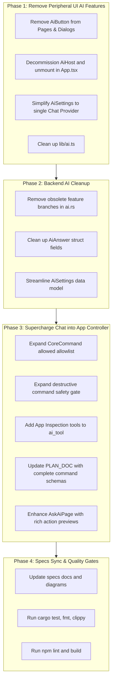

# Plan: Consolidation of AI Features into Central App-Controlling Chat Assistant

## 1. Executive Summary

This plan outlines the removal of all peripheral, scattered AI features across OpenLocalServer (OLS) and the consolidation and expansion of the **Ask AI Chat Assistant** into a unified, powerful app controller. 

Following this plan:
1. **Removed**: All secondary buttons (`AiButton`), contextual popup dialogs (`AiHost`), per-feature provider routing matrices in Settings, and specialized feature prompt branches (`explain`, `config`, `logs`, `traffic`, `commit`, `palette`).
2. **Retained & Supercharged**: The central **Ask AI** chat interface (`AskAiPage`). It becomes the single conversational front door capable of answering technical and environmental questions AND orchestrating **any action in the application** (creating/editing/removing sites, exporting/importing site bundles, managing services, creating/controlling public tunnels, database management, runtime installations, DNS, certificates, and profiles).
3. **Safety Maintained**: Adherence to the core OLS safety mandate: *"The AI proposes, the core disposes"*. The chat assistant will construct and propose structured `ols-plan` action batches, which the user reviews, selects, and approves with explicit confirmation for destructive actions before execution.

---

## 2. Inventory of Current AI Surface Area

### 2.1 Frontend Files & Components
| Component / File | Current Role | Planned Action |
| :--- | :--- | :--- |
| `ui/src/components/ai/AiButton.tsx` | Button triggering contextual AI popups | **Delete file** after removing usages |
| `ui/src/components/ai/AiHost.tsx` | Modal dialog rendered by `askAi(...)` | **Delete file** and unmount from `App.tsx` |
| `ui/src/lib/ai.ts` | Event bus & state bridge for `AiHost` | **Refactor/Streamline** into chat settings state |
| `ui/src/components/ai/AiSettings.tsx` | Multi-feature provider matrix | **Simplify** to single Assistant model config |
| `ui/src/pages/Config.tsx` | "Suggest with AI" button | **Remove** `AiButton` |
| `ui/src/components/site/HtaccessEditor.tsx` | "Suggest with AI" button | **Remove** `AiButton` |
| `ui/src/pages/Tunnels.tsx` | "Explain", "k6", "Mock handler" buttons | **Remove** `AiButton` calls |
| `ui/src/pages/Logs.tsx` | "Ask AI" log analysis button | **Remove** `askAi` button & import |
| `ui/src/components/project/GitPanel.tsx` | "Draft commit message" button | **Remove** `AiButton` |
| `ui/src/components/project/EnvironmentPanel.tsx` | AI suggest/explain buttons | **Remove** `AiButton` |
| `ui/src/components/DoctorDialog.tsx` | "Ask AI" finding explanation | **Remove** `AiButton` |
| `ui/src/components/DiagnosticsCard.tsx` | "Ask AI" finding explanation | **Remove** `AiButton` |
| `ui/src/components/CommandPalette.tsx` | Plain-language AI query | **Remove** `askAi` entry |
| `ui/src/App.tsx` | Mounts `<AiHost />` | **Remove** `<AiHost />` mount |
| `ui/src/pages/AskAi.tsx` | Main Chat Assistant page | **Retain & Expand** with full app control |

### 2.2 Backend (`crates/ols-core/src/ai.rs`)
| Item | Current Role | Planned Action |
| :--- | :--- | :--- |
| `pub const FEATURES` | `explain`, `config`, `logs`, `traffic`, `commit`, `palette`, `app_guide` | **Reduce** to single feature (`assistant` / `app_guide`) |
| `Inner::ai_context` | Specialized attachments for the 7 features | **Remove** the 6 peripheral branches; streamline into the unified chat context |
| `AiAnswer` | Carries `manifest`, `file`, `script`, `commit_message` | **Remove** specialized artifact fields; keep `text`, `actions`, `rejected`, `used` |
| `allowed(cmd: &CoreCommand)` | Allowlist restricted to ~26 commands | **Expand** to cover all app domains (Sites, Bundles, Tunnels, Services, DBs, etc.) |
| `destructive(cmd: &CoreCommand)` | Destructive check | **Update** with all newly allowed mutating commands |
| `tool_defs()` & `ai_tool()` | Read-only inspection tools (11 tools) | **Expand** with `list_tunnels`, `list_databases`, `list_runtimes`, `list_profiles`, `get_site_details`, `list_tasks` |
| `PLAN_DOC` & `SYSTEM` | Prompts describing commands | **Update** with complete JSON schemas and instructions for all app operations |

---

## 3. Phase-by-Phase Implementation Plan



### Phase 1: Removal of Peripheral UI AI Components
1. **Scattered `AiButton` and `askAi` removals**:
   - `ui/src/pages/Config.tsx`: Remove the `AiButton` from the config header and associated helper functions.
   - `ui/src/components/site/HtaccessEditor.tsx`: Remove `AiButton` ("Suggest with AI").
   - `ui/src/pages/Tunnels.tsx`: Remove "Explain", "Generate k6 script", and "Draft mock handler" buttons from request inspector.
   - `ui/src/pages/Logs.tsx`: Remove "Ask AI" button from the log viewer header.
   - `ui/src/components/project/GitPanel.tsx`: Remove "Generate commit message with AI".
   - `ui/src/components/project/EnvironmentPanel.tsx`: Remove AI suggestions for `.env`.
   - `ui/src/components/DoctorDialog.tsx` & `ui/src/components/DiagnosticsCard.tsx`: Remove `AiButton` and `explainFinding`.
   - `ui/src/components/CommandPalette.tsx`: Remove `askAi` command item.
2. **Decommission `AiHost` & `AiButton`**:
   - Delete `ui/src/components/ai/AiButton.tsx`.
   - Delete `ui/src/components/ai/AiHost.tsx`.
   - In `ui/src/App.tsx`: Remove `<AiHost onNavigate={navigate} />` and its import.
3. **Refactor `ui/src/lib/ai.ts`**:
   - Strip out `registerAiHost`, `askAi`, `AskAi` interface, and modal listeners.
   - Retain AI state hooks (`useAiState`, `setAiState`) used by `Settings` and `AskAiPage`.
4. **Simplify `ui/src/components/ai/AiSettings.tsx`**:
   - Remove the "Features" mapping section (which mapped each feature like `explain`, `config`, `logs`, etc. to different providers).
   - Display a single, clear active provider & model configuration for the Chat Assistant.

---

### Phase 2: Backend AI Cleanup (`crates/ols-core/src/ai.rs`)
1. **Feature Definitions**:
   - Update `pub const FEATURES: &[(&str, &str)]` to include only the chat assistant:
     ```rust
     pub const FEATURES: &[(&str, &str)] = &[("assistant", "Chat Assistant")];
     ```
2. **Streamline `ai_context`**:
   - Remove handlers for `"explain"`, `"config"`, `"logs"`, `"traffic"`, `"commit"`, and `"palette"`.
   - Route all requests to the comprehensive assistant prompt generator (consolidating the rich knowledge base, live environment status, and manual facts).
3. **Clean Up `AiAnswer`**:
   - Remove dead fields: `manifest: Option<String>`, `file: Option<String>`, `script: Option<String>`, `commit_message: Option<String>`.
   - Keep:
     ```rust
     pub struct AiAnswer {
         pub text: String,
         pub actions: Vec<AiAction>,
         pub rejected: Vec<String>,
         pub provider: String,
         pub model: String,
         pub local: bool,
         pub tokens_in: Option<u64>,
         pub tokens_out: Option<u64>,
         pub cost_usd: Option<f64>,
         pub used: Vec<String>,
     }
     ```

---

### Phase 3: Supercharging Chat to Control Any App Operation

#### 3.1 Expanding the Allowed Command Set (`allowed` in `ai.rs`)
Expand `pub fn allowed(cmd: &CoreCommand) -> bool` to cover all application capabilities:
- **Sites / Domains**:
  - `AddDomain { domain }` (Create new site)
  - `UpdateDomain { domain }` (Modify site configs: PHP version, root, web server, etc.)
  - `RemoveDomain { hostname }` (Delete site)
  - `SetDomainEnabled { hostname, enabled }` (Toggle site on/off)
  - `BulkSetDomainsEnabled { hostnames, enabled }`
  - `BulkRemoveDomains { hostnames }`
  - `BulkSetDomainServer { hostnames, server }`
  - `DuplicateDomain { hostname, new_hostname }`
  - `RenameDomain { hostname, new_hostname }`
  - `SyncAutoDomains`
  - `RegisterProject { path }`
  - `RemoveProject { id }`
  - `DeleteProject { id }`
- **Site Bundles**:
  - `ExportSites { hostnames, options, dest, password }`
  - `ImportSites { source, password, on_conflict, name, options }`
  - `PreviewSiteBundle { source }`
  - `ExportSupportBundle { dest }`
- **Services**:
  - `StartService { id }`
  - `StopService { id }`
  - `RestartService { id }`
  - `StopAll`
  - `SaveCustomService { service }`
  - `RemoveCustomService { id }`
- **Tunnels**:
  - `StartTunnel { id }`
  - `StopTunnel { id }`
  - `SaveTunnel { tunnel }`
  - `RemoveTunnel { id }`
  - `CheckTunnel { id }`
  - `SetTunnelToken { provider, token }`
  - `SetTunnelPassword { id, password }`
- **Databases**:
  - `CreateDatabase { engine, name, charset, collation }`
  - `BackupDatabase { engine, database }`
  - `RestoreDatabase { engine, database, file }`
  - `ListDatabases { engine }`
- **Web Servers**:
  - `ApplyWeb { overwrite }`
  - `ValidateWeb`
  - `StopWeb`
  - `RestartSiteApp { hostname }`
- **Runtimes & Extensions**:
  - `InstallRuntime { id, version }`
  - `RemoveRuntime { id, version }`
  - `SetPhpExtension { version, extension, enabled }`
  - `InstallPhpExtension { version, extension }`
- **Certificates, DNS & Networking**:
  - `SyncHosts`
  - `TrustCa`
  - `RegenerateCertificate { hostname }`
  - `VerifySslFiles { hostname }`
  - `IssueLetsEncrypt { hostname }`
  - `SyncDdns { hostname }`
  - `DetectPublicIp`
  - `SyncAllDdns { force }`
- **Profiles & Snapshots**:
  - `ApplyProfile { id }`
  - `CreateSnapshot { label, project_id, include_files, include_env, databases }`
  - `RestoreSnapshot { file, project_id, options }`
- **Quick Apps & Project Tools**:
  - `StartQuickApp { id, values, .. }`
  - `ApplySetup { project_id, dry_run }`
  - `ApplyMailpitEnv { project_id, file }`
  - `SetEnvValue { project_id, file, key, value }`
  - `RunComposer { project_id, action }`

#### 3.2 Updating the Destructive Safety Gate (`destructive` in `ai.rs`)
Ensure operations that replace, delete, or overwrite data are strictly flagged as `destructive`:
```rust
pub fn destructive(cmd: &CoreCommand) -> bool {
    crate::repair::is_destructive(cmd)
        || matches!(
            cmd,
            CoreCommand::RemoveDomain { .. }
                | CoreCommand::DeleteProject { .. }
                | CoreCommand::BulkRemoveDomains { .. }
                | CoreCommand::RemoveTunnel { .. }
                | CoreCommand::RemoveCustomService { .. }
                | CoreCommand::RemoveRuntime { .. }
                | CoreCommand::StopAll
                | CoreCommand::RestoreDatabase { .. }
                | CoreCommand::RestoreSnapshot { .. }
                | CoreCommand::ImportSites { .. }
                | CoreCommand::SetEnvValue { .. }
        )
}
```

#### 3.3 Adding Rich Inspection Tools (`tool_defs` & `ai_tool`)
Equip the LLM with live query tools so it can verify current state before generating plans:
1. `list_tunnels`: Returns all tunnels, provider, target, active state, and public hostname.
2. `list_databases`: Returns databases across MariaDB, PostgreSQL, and SQLite.
3. `list_runtimes`: Returns installed versions and available catalog runtimes.
4. `list_profiles`: Returns available configuration profiles.
5. `get_site_details`: Returns complete configuration of a specific domain (root, runtime, web server, SSL, tunnel, path prefix).
6. `list_tasks`: Returns background tasks and their statuses.

#### 3.4 Updating `PLAN_DOC` & System Prompt
Update the prompt documentation with clear, concrete JSON structures for all supported commands so the model generates valid, schema-compliant JSON in the `ols-plan` block:
- Adding sites (`add_domain`)
- Bundles (`export_sites`, `import_sites`)
- Tunnels (`start_tunnel`, `stop_tunnel`, `save_tunnel`)
- Services (`start_service`, `stop_service`, `restart_service`)
- Databases (`create_database`, `backup_database`)
- Runtimes (`install_runtime`)

#### 3.5 Enhancing Chat Execution UI (`AskAi.tsx`)
- Display human-readable command descriptions with badges (e.g. `replaces something`, `destroys data`).
- Provide an expandable "View Parameters" disclosure for each step so the user can verify paths, hostnames, and settings before clicking "Run".
- Provide inline progress indicators for multi-step plans (e.g. Step 1: Add site -> Step 2: Create MariaDB DB -> Step 3: Start tunnel).
- Update starter prompts to demonstrate app control (e.g., *"Create a new site called myapp.test with PHP 8.3 and MariaDB"*, *"Start Cloudflare tunnel for mysite.test"*, *"Export a bundle for shop.test"*).

---

## 4. Specs Synchronization (AGENTS.md Mandate)

In accordance with rule #1 in `AGENTS.md`, the following specification documents will be updated:
1. `specs/catalog.txt`:
   - Remove `AiBus/AiHost/AiButton` entry.
   - Update `AskAiPage` entry to reflect its expanded role as the conversational app controller.
   - Update `LogsPage`, `WebServerPage`, `TunnelsPage`, etc., removing AI button mentions.
2. `specs/relationships.txt`:
   - Remove references to `AiHost`, `AiButton`, and page-level AI dialog integrations.
   - Update `AskAi` relationships with `DomainStore`, `TunnelManager`, `ServiceManager`, `SiteBundler`, etc.
3. `specs/data_models.txt`:
   - Update `AiSettings` and `AiAnswer` models.
4. `specs/api_reference.md`:
   - Document the expanded command allowlist in `ai_apply`.
5. `specs/full_documentation.md`:
   - Update the architecture and frontend file analysis sections.
6. `specs/runtime.md`:
   - Append a detailed log entry under `## Log` summarizing the consolidation and verified file count (`Files Processed`).

---

## 5. Verification & Quality Gates

The plan includes running all mandatory quality checks:
```bash
cargo fmt --all
cargo clippy -p ols-core -p ols-helper --all-targets
cargo test -p ols-core -p ols-helper
cd ui && npm run lint && npm run build
```

---

## 6. Summary of Impact

| Metric | Before | After |
| :--- | :--- | :--- |
| **Scattered AI UI buttons** | 8+ locations | 0 (All consolidated into Chat) |
| **Popup AI modal dialogs** | 1 (`AiHost`) | 0 (No popup interruptions) |
| **Chat app control scope** | ~26 read-heavy commands | Full app orchestration (Sites, Bundles, Tunnels, Services, DBs, Runtimes, SSL, DNS) |
| **LLM query tools** | 11 tools | 17+ tools (Tunnels, DBs, Tasks, Runtimes, Profiles, Site details) |
| **Safety** | High (human-in-the-loop) | High (preserved: AI proposes, human confirms destructive steps) |
